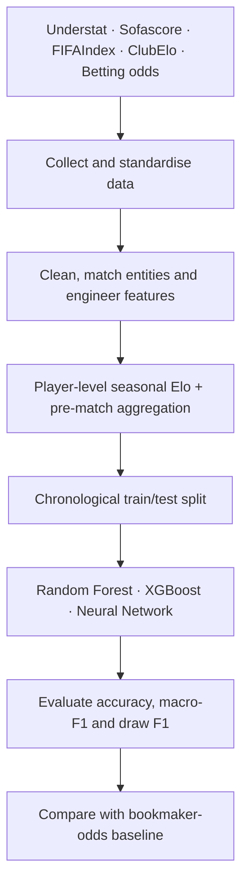

# Premier League Match Outcome Prediction

**MSc Data Science Dissertation · University of Birmingham · 2024–2025**

Predicting **home wins, draws, and away wins** in the English Premier League using multi-source football data, player-level Elo ratings, engineered pre-match features, and machine learning.

**[Read the full dissertation (PDF)](Dissertation.pdf)**

## Project at a glance

- **Scope:** Nine Premier League seasons, from **2015/16 to 2023/24**.
- **Data sources:** Understat, Sofascore, FIFAIndex, ClubElo, and Football-Data.co.uk.
- **Technical work:** Web scraping, API data collection, data cleaning, entity matching, feature engineering, and predictive modelling.
- **Models:** Random Forest, XGBoost, and neural networks.
- **Evaluation:** Chronological train/test split; accuracy, macro-F1, and draw-class F1.

## Key results

The thesis compared a **draw-weighted neural network using aggregated pre-match features** against a bookmaker-odds baseline on the **same 684-match test set**.

| Approach | Accuracy | Macro-F1 | Draw F1 |
|:--|--:|--:|--:|
| Bookmaker-odds baseline | 57.7% | 0.423 | 0.000 |
| **Draw-weighted neural network** | **63.2%** | **0.612** | **0.333** |

*Reported in dissertation Table 6.4. These are research evaluation results, not claims of guaranteed performance in future seasons.*

## What I built

**1. Multi-source data pipeline.** Collected and harmonised player- and match-level statistics using Python, public APIs, and scraping tools. Standardised dates and identifiers; reconciled team and player names across sources.

**2. Custom seasonal player Elo.** Implemented player-level ratings updated using league matches and reset each season, then aggregated ratings to represent team strength.

**3. Pre-match feature engineering.** Built measures such as *Game Dominance* (possession × pass accuracy), plus rolling statistics and model-based aggregations to estimate features before kick-off. Post-match features were also retained for diagnostic comparisons, rather than treated as deployable pre-match inputs.

**4. Model comparison and evaluation.** Compared Random Forest, XGBoost, and neural networks under multiple feature representations; assessed class imbalance and the difficulty of predicting draws.

## Project workflow

## Selected notebooks

The dissertation appendix documents the complete project. Good places to start in the code are:

| Notebook | What it demonstrates |
|:--|:--|
| `player elo calculation.ipynb` | Custom player-level Elo feature engineering |
| `fifa name matching.ipynb` | Cross-source player-name matching |
| `merging and analyzing.ipynb` | Integrating datasets and exploratory analysis |
| `modeling.ipynb` | Final model training, evaluation, and betting-baseline comparison |

Other notebooks cover Understat, Sofascore, FIFAIndex, ClubElo, feature aggregation, and cleaning.

## Tools and methods

**Python 3.12.4** · pandas · scikit-learn · XGBoost · TensorFlow/Keras · Selenium · ScraperFC · RapidFuzz · Jupyter Notebook

**Methods:** supervised classification, regression-based imputation, seasonal Elo, rolling aggregation, feature importance, class weighting, and temporal evaluation.

## Reproducing the work

The notebooks are research artifacts rather than a one-click application. Their original execution order and dataset branches are described in **Appendix A** of the dissertation.

- Some data paths in the notebooks may need updating after reorganising the repository.
- **Do not run the data-scraping notebooks by default.** They are intended for rebuilding source datasets and may take many hours; respect each data provider's terms and access restrictions.
- Run the cleaning, feature-engineering, and modelling notebooks only after verifying that their expected input files and dependencies are present.

## Limitations and next steps

Draw outcomes remained difficult to predict. Entity resolution across data providers required manual checks, and the project was limited by data availability and time. Next steps include stronger automated matching, more leagues and seasons, improved probabilistic calibration, and revisiting feature selection within training/validation folds before a final untouched test evaluation.

---

**Full methodology, results, and references:** [Dissertation.pdf](Dissertation.pdf)
